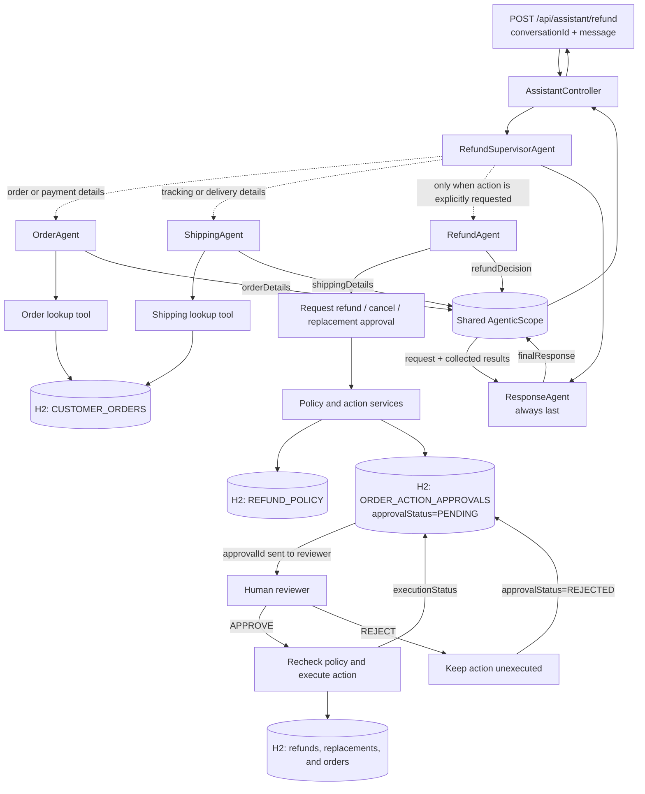

# Multi-agent order workflow

This beginner example compares two ways to coordinate LangChain4j agents:

- **Sequence:** a fixed order; every configured agent runs in turn.
- **Supervisor:** an LLM chooses which specialist to call and when. The supervisor is the active workflow used by `POST /api/assistant/refund`.

The LangChain4j agentic module is experimental, so APIs may change in later releases.

## Active flow: supervisor



The supervisor may skip specialists that are not relevant. It should use the order and shipping specialists for order questions, call `RefundAgent` only for an explicitly requested action, and call `ResponseAgent` last. The supervisor is responsible for routing and composing the task; it does not decide policy eligibility. Mutating tools create an approval request; they never execute the action themselves.

## Agent responsibilities and shared scope

| Agent | Responsibility | Reads from scope | Writes to scope |
| --- | --- | --- | --- |
| `RefundSupervisorAgent` | Routes the request to relevant specialists and ensures the final response agent runs last. | `request` and prior specialist results | `finalResponse` |
| `OrderAgent` | Verifies order number, order status, payment status, and total through a read-only tool. | `request` | `orderDetails` |
| `ShippingAgent` | Verifies shipping status, carrier, tracking number, and timestamps through a read-only tool. | `request` | `shippingDetails` |
| `RefundAgent` | Creates a pending approval for an explicitly requested refund, cancellation, or replacement. | `request`; verified details as context | `refundDecision` |
| `ResponseAgent` | Summarizes the relevant verified facts and action outcome in a natural customer-facing response. | `request`, `orderDetails`, `shippingDetails`, `refundDecision` | `finalResponse` |

`AgentConfiguration` creates each specialist with its own prompt, tools, description, chat-memory provider, and `outputKey`. Those output keys are values in the shared `AgenticScope`; `@V("...")` names in agent methods refer to those values. The supervisor initializes default text for the three specialist result keys, so the final agent can clearly say when a lookup or action was not performed. `@MemoryId` identifies conversation history; it is separate from the shared workflow scope.

`ResponseAgent` returns a concise 2–3 sentence natural-language summary. It mentions only details relevant to the request and does not expose the agents' step-by-step work. The supervisor uses `SupervisorResponseStrategy.LAST`, returning the final response agent's output instead of a generated summary of the agent activity.

The approval review happens after the assistant's HTTP request has returned. Rather than blocking a model call inside LangChain4j's in-process `HumanInTheLoop` callback, the action tool stores a pending approval in H2 and returns its ID. A separate reviewer HTTP call decides whether to approve or reject it. This keeps the example usable with a normal request/response API; the approval table, not the conversational memory, is the source of truth.

## Fixed sequence reference

The sequence bean remains commented out in `AgentConfiguration` as a side-by-side reference. To use it instead, enable that bean and inject `WorkflowSupportAgent`. Its fixed order is:

```text
OrderAgent -> ShippingAgent -> RefundAgent -> ResponseAgent
```

Unlike the supervisor, a sequence always invokes each agent in order. The sequence uses the same specialist output keys, tools, and policies. In the active configuration the supervisor bean is enabled and the sequence bean is not, so there is no ambiguity about which workflow the HTTP endpoint uses.

## Refund policy and action safeguards

The `REFUND_POLICY` table is action-specific. Its `DELAY_REFUND` rows follow the referenced policy:

| Action | Order status | Eligible | Policy message |
| --- | --- | --- | --- |
| `DELAY_REFUND` | `DELIVERED` | No | Delivered orders are not eligible for a delay refund. |
| `DELAY_REFUND` | `SHIPPED` | No | The order is already shipped. Wait until the promised delivery date. |
| `DELAY_REFUND` | `PROCESSING` | No | Processing orders are not eligible for a delay refund. |
| `DELAY_REFUND` | `DELAYED` | Yes | Delayed orders are eligible for a refund. |
| `DELAY_REFUND` | `CANCELLED` | No | Cancelled orders are already closed. |

Other action types cover cancellation of delayed orders and refunds/replacement requests for delivered orders. Services verify payment and shipping state and reject duplicate or mutually exclusive actions before a pending approval is created. The LLM can request an action, but it cannot approve it or execute it.

Seed data covers several different combinations:

| Order | Order status | Payment status | Shipping status | What it demonstrates |
| --- | --- | --- | --- | --- |
| `ORD-1001` | `DELIVERED` | `PAID` | `DELIVERED` | Eligible delivered-order action example. |
| `ORD-1002` | `SHIPPED` | `PAID` | `IN_TRANSIT` | Shipping lookup and cancellation rejection after shipment. |
| `ORD-1003` | `PROCESSING` | `PENDING` | `NOT_SHIPPED` | Unpaid order that is still processing. |
| `ORD-1004` | `DELAYED` | `PAID` | `DELAYED` | Eligible delayed-order refund/cancellation example. |
| `ORD-1005` | `DELAYED` | `PENDING` | `DELAYED` | Payment check rejects an unpaid delayed order. |
| `ORD-1006` | `DELAYED` | `PAID` | `IN_TRANSIT` | A delayed order that has already shipped cannot be cancelled. |
| `ORD-1007` | `DELIVERED` | `PENDING` | `DELIVERED` | Payment check rejects an unpaid delivered-order action. |
| `ORD-1008` | `PROCESSING` | `PAID` | `NOT_SHIPPED` | Paid order that is not yet eligible for delayed-order actions. |

A replacement action records a `REQUESTED` row in `REPLACEMENT_REQUESTS`; it does not create a replacement order or shipment.

## Console trace

`RefundWorkflowListener` is attached to the active supervisor and inherited by its child agents. It logs the workflow start/end and each agent start/completion/failure. Results are shortened for readability:

```text
[refund-supervisor] START conversation=assistant:refund:refund-demo
[refund-supervisor] START agent=orderAgent
[refund-supervisor] DONE agent=orderAgent outputKey=orderDetails result=Verified order ORD-1001; order status: DELIVERED; payment status: PAID; ...
[refund-supervisor] START agent=shippingAgent
[refund-supervisor] DONE agent=shippingAgent outputKey=shippingDetails result=Verified shipping details for order ORD-1001; shipping status: DELIVERED; ...
[refund-supervisor] START agent=refundAgent
[refund-supervisor] DONE agent=refundAgent outputKey=refundDecision result=approvalStatus=PENDING; executionStatus=NOT_STARTED; DELIVERED_REFUND for order ORD-1001 is eligible and awaiting human approval. Approval ID: 0b...
[refund-supervisor] START agent=responseAgent
[refund-supervisor] DONE agent=responseAgent outputKey=finalResponse result=Your order ORD-1001 was delivered. Your refund request is waiting for review; no refund has been issued yet.
[refund-supervisor] END conversation=assistant:refund:refund-demo
```

Results can contain order details, so avoid logging full agent output in production unless that information is appropriate for application logs.

## Human review and execution

Eligible refund, delayed-cancellation, replacement, and ordinary order-cancellation requests are stored as `PENDING` in `ORDER_ACTION_APPROVALS`. The assistant response includes the approval ID. The human reviewer can inspect the request, then approve or reject it:

```powershell
$approvalId = "approval-id-from-the-assistant-response"

# List pending requests.
curl.exe "http://localhost:8080/api/assistant/approvals/pending"

# Approve; use /reject instead to reject without executing the action.
curl.exe -X POST "http://localhost:8080/api/assistant/approvals/$approvalId/approve" `
  -H "Content-Type: application/json" `
  -d '{"reviewerName":"Store Manager","note":"Verified the request"}'

curl.exe -X POST "http://localhost:8080/api/assistant/approvals/$approvalId/reject" `
  -H "Content-Type: application/json" `
  -d '{"reviewerName":"Store Manager","note":"Request does not meet policy"}'
```

The decision request is a simple JSON body; the reviewer does not need to use the application console. A successful approval returns an `ApprovalResponse`, for example:

```json
{
  "approvalId": "a1b2c3",
  "orderNumber": "ORD-1004",
  "action": "DELAY_REFUND",
  "amount": 59.99,
  "reason": "Delivery was delayed",
  "approvalStatus": "APPROVED",
  "executionStatus": "SUCCEEDED",
  "reviewerName": "Store Manager",
  "decisionNote": "Verified the request",
  "executionResult": "Simulated refund recorded for order ORD-1004 for 59.99. No payment provider was contacted.",
  "createdAt": "2026-11-15T10:00:00",
  "reviewedAt": "2026-11-15T10:05:00",
  "executedAt": "2026-11-15T10:05:00"
}
```

Approval decision and action execution are tracked separately: `approvalStatus` is `PENDING`, `APPROVED`, or `REJECTED`; `executionStatus` is `NOT_STARTED`, `SUCCEEDED`, or `FAILED`. Approval re-runs the eligibility and duplicate-action checks before execution, and a rejected request is never executed. Refund records are written to `REFUND_TRANSACTIONS`, replacement requests to `REPLACEMENT_REQUESTS`, and approved cancellations update `CUSTOMER_ORDERS`.

The review endpoints do not require a token or login in this tutorial. They are intentionally simple for local learning; do not expose this application publicly without adding authenticated, role-based reviewer access.

The approval request is persisted so a human can review it in a separate HTTP call instead of keeping the original model request blocked. H2 is in-memory, so pending approvals are lost when the application restarts. These actions are simulations only: no payment processor is contacted and no money is moved.

Create a pending approval through the assistant endpoint using the same JSON shape as other assistant endpoints:

```json
{
  "conversationId": "refund-demo",
  "message": "Please refund order ORD-1001 because it arrived damaged."
}
```

Reuse `conversationId` for follow-up turns in the same refund conversation. In-memory chat history is cleared when the application restarts.
