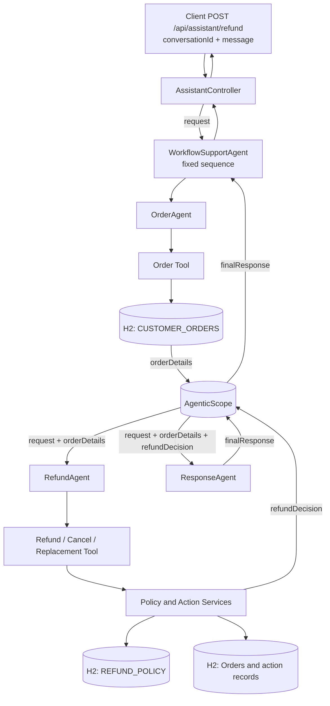

# Multi-agent refund workflow

This example shows a **sequential multi-agent workflow** implemented with LangChain4j's `langchain4j-agentic` module. The HTTP controller starts the workflow; the agents do not invoke one another directly.

LangChain4j currently marks the agentic module as experimental, so its APIs may change in later releases.

## Flow



## What each agent does

| Agent | Responsibility | Shared result |
| --- | --- | --- |
| `OrderAgent` | Finds the order number, calls the read-only order tool, and returns verified order, payment, and shipping details. | `orderDetails` |
| `RefundAgent` | Chooses the requested action and calls the matching tool. The service checks the saved policy and records or rejects the action. | `refundDecision` |
| `ResponseAgent` | Turns the request, order details, and action result into a helpful customer response. | `finalResponse` |

`AgentConfiguration` builds the three agents with the configured Gemini chat model, tools, and separate conversation-memory providers. `AgenticServices.sequenceBuilder(WorkflowSupportAgent.class)` runs them in the fixed order shown above. The sequence is a workflow; the LLM does not choose which agent runs next.

`AgentConfiguration` assigns the outputs with `.outputKey("orderDetails")`, `.outputKey("refundDecision")`, and `.outputKey("finalResponse")`. Those values are stored in the shared `AgenticScope` and supplied to the next agent through matching `@V` names. The sequence's `.outputKey("finalResponse")` tells it which value its `String` method returns. Output keys are needed where a workflow passes or returns an agent result; they are not required for every standalone agent. `@MemoryId` is separate: it gives each agent its own conversation history.

Each agent has an explicit `@SystemMessage` for its role and rules, and a `@UserMessage` for changing request/workflow data. System messages are optional, but keeping stable instructions separate makes each agent easier to understand and maintain.

## Refund policy

The `REFUND_POLICY` table is the screenshot's policy table plus an `action_type` column. This lets the same order status have different rules for different actions. Its `DELAY_REFUND` rows follow the screenshot exactly:

| Action | Order status | Eligible | Policy message |
| --- | --- | --- | --- |
| `DELAY_REFUND` | `DELIVERED` | No | Delivered orders are not eligible for a delay refund. |
| `DELAY_REFUND` | `SHIPPED` | No | The order is already shipped. Wait until the promised delivery date. |
| `DELAY_REFUND` | `PROCESSING` | No | Processing orders are not eligible for a delay refund. |
| `DELAY_REFUND` | `DELAYED` | Yes | Delayed orders are eligible for a refund. |
| `DELAY_REFUND` | `CANCELLED` | No | Cancelled orders are already closed. |

Other action types in the same table cover cancellation of delayed orders and refunds/replacement requests for delivered orders. Every action additionally requires `PAID`; delayed cancellation also checks that shipment has not started. The LLM can request an action, but the service and policy table make the final eligibility decision.

`ORD-1004` is seeded as a paid, delayed, not-yet-shipped order. `ORD-1002` is paid and shipped/in transit, so it cannot be cancelled.

“Request a replacement” records a `REQUESTED` row in `REPLACEMENT_REQUESTS`. It does not create a new order or shipment; inventory and fulfillment are outside this learning example.

## Console trace

`RefundWorkflowListener` is attached to the sequence in `AgentConfiguration` and is inherited by its child agents. It logs the workflow start/end and each agent start/completion/failure. Results are shortened to keep logs readable:

```text
[refund-workflow] START conversation=assistant:refund:refund-demo
[refund-workflow] START agent=orderAgent
[refund-workflow] DONE agent=orderAgent outputKey=orderDetails result=Verified order ORD-1001; order status: DELIVERED; payment status: PAID; shipping status: DELIVERED; total: 89.99.
[refund-workflow] START agent=refundAgent
[refund-workflow] DONE agent=refundAgent outputKey=refundDecision result=Simulated refund recorded for order ORD-1001 for 89.99. No payment provider was contacted.
[refund-workflow] START agent=responseAgent
[refund-workflow] DONE agent=responseAgent outputKey=finalResponse result=...
[refund-workflow] END conversation=assistant:refund:refund-demo
```

The result is shortened to keep logs readable. It can contain order details, so do not log full agent results in a production application unless that data is appropriate for application logs.

## Refund safety and persistence

The refund agent is not the final authority on eligibility. The application services look up the policy record and independently check payment/shipping state and existing actions:

1. The order exists.
2. Its payment is `PAID`.
3. Delay refunds require status `DELAYED`; the screenshot's other delay-refund statuses are rejected.
4. Delivered refunds and replacement requests use their own action-specific policy rows.
5. Delayed cancellation requires status `DELAYED` and no shipment.
6. No opposite or duplicate refund/replacement action already exists for that order.

Eligible refunds are recorded in `REFUND_TRANSACTIONS`, and the order's payment status becomes `REFUNDED` in the same database transaction. A delayed paid order can also be cancelled before shipment. A replacement request is stored in `REPLACEMENT_REQUESTS`; it records a request only and does not create an order or shipment. A replacement and refund cannot both be recorded for the same order. These are learning-project simulations only: no payment processor is contacted and no money is moved.

The workflow endpoint accepts the same JSON shape as the other assistant endpoints:

```json
{
  "conversationId": "refund-demo",
  "message": "Please refund order ORD-1001 because it arrived damaged."
}
```

Use the same `conversationId` for follow-up turns in the same refund conversation. The in-memory chat history is cleared when the application restarts.
